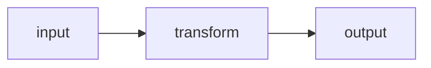

# readme-forge

A README has one job: let a stranger decide, in under 30 seconds, whether this
repo is worth their time. Most AI-written READMEs fail at that job — not because
of bad prose, but because they are written for the wrong reader.

This skill fixes the reader.

## The core failure it targets

When an LLM is asked to "write a README", it often produces a second document
inside the first: a launch plan, a headline shortlist, an image brief, a list of
publishing platforms. The model was writing notes to itself and left them in the
deliverable.

Real example found in the wild:

```markdown
## 六、如何把本文扩展成一篇发布稿

- **标题建议**：《我用 600 行纯 Python 手写了 PyTorch 的内核》
- **配图建议**：画一张"前向建图 → 反向求导"的示意图
- **钩子开头**：从"你真的懂 loss.backward()"这种反问切入
- **发布平台**：适合掘金 / 知乎；B 站讲"手写框架"系列非常有受众
```

That is the author talking to himself, printed in a shop window.
Any visitor reads it as "machine output" and leaves.

**First rule of this skill: the README is for the reader, never for the author.**

## Workflow

### 1. Diagnose before rewriting

Never rewrite blind. Run the audit and show the findings first.

```
python scripts/readme-audit.py --dir <repo>          # local
python scripts/readme-audit.py --repo USER/REPO      # remote
```

Or apply the checklist by hand:

| # | Check | Fails when |
|---|---|---|
| 1 | Author-facing meta text | contains 发布稿 / 标题建议 / 配图建议 / 钩子 / 发布平台 / launch post / headline options / image brief |
| 2 | Platform promotion | mentions 掘金 / 知乎 / B站 / 公众号 / Reddit / HN as places to post the article |
| 3 | Badge count | more than 3 badges |
| 4 | Badges are static | every badge is a hand-written string (`badge/dependencies-0`) instead of live data (`/github/stars/…`, `/npm/v/…`) |
| 5 | Real images | zero non-badge images — no screenshot, no diagram, no GIF, no chart |
| 6 | Claimed-but-missing assets | text says "the architecture diagram above" and no image exists |
| 7 | Unverifiable numbers | "60 tests passing", "10x faster" with no command in the repo that produces that number |
| 8 | Reader address | "读者朋友" / "话不多说" / "Let's dive in!" |
| 9 | Length | over 4,000 characters — a sign of padding, not depth |
| 10 | Time-to-first-code | first runnable code block appears after the 40th line |
| 11 | Feature-list tagline | the subtitle is an enumeration (`FIFO, LRU, LFU, LRU-K, SLRU, ARC, TinyLFU`) instead of a hook |
| 12 | No run command | a stranger cannot copy-paste one line and see it work |
| 13 | Topic stuffing | more than 5 topics, most of them aspirational rather than accurate |

Report every failure with the exact offending text. Do not paraphrase it —
quote it, so the user sees what a stranger sees.

### 2. Decide the one-line pitch

Answer three questions in one sentence each. Do not proceed until they are
answerable from the code:

- What does this do that a competent engineer could not do in an afternoon?
- Who specifically is stuck without it?
- What is the smallest command that proves it works?

If question one has no answer, the problem is the project, not the README.
Say so. A README cannot rescue a repo that has nothing to say.

### 3. Rewrite to this skeleton

```markdown
# <Name>

<One sentence. Concrete. No adjectives that cannot be measured.>

<One real image: diagram, screenshot, benchmark chart, or terminal GIF.
 GitHub renders ```mermaid blocks natively — use them when no asset exists.>

## Install

<copy-pasteable, one line if possible>

## Quick start

<Under 20 lines. Includes the actual output the reader will see.>

## Why this exists

<The design tradeoff. What was rejected, and what it costs. Honest.>

## API

<Table or list of the surface that matters. Not everything — the 20% that gets used.>

## Benchmarks   <!-- only if real numbers exist and are reproducible -->

<Command that produces the number, then the number, then the comparison baseline.>

## License
```

Target: **300–800 characters** excluding code blocks.
Length is not a virtue. A short README that gets the reader to `pip install`
beats a long one that gets them to scroll.

### 4. Make every claim carry a witness

| Claim | Invalid | Valid |
|---|---|---|
| Speed | "10x faster" | `python bench.py` → `readme-forge: 12.4ms · baseline: 138ms` |
| Correctness | "60 tests passing" | `pytest -q` → `60 passed`, plus the CI badge that links to the run |
| Zero dependencies | "zero-dependency" | `cat pyproject.toml` shows no `dependencies` array |
| Production ready | "battle-tested" | delete the sentence; it cannot be witnessed |

**Rule: if a number has no command behind it, delete the number, not the
sentence around it.** Deleting the number and keeping the claim is worse than
useless — it is a lie with the evidence removed.

### 5. Replace decoration with evidence

Badges count as decoration. A reader learns nothing from
`badge/dependencies-0`.

Keep at most three, and prefer ones that change over time:

```markdown


```

Then spend the effort on one real image. A Mermaid diagram that renders is
worth more than six shields:

````markdown

````

### 6. Verify the rewrite

Re-run the audit. It must exit 0. Then read the result top to bottom and ask
one question:

> Would I star this if a stranger had written it?

If the answer is no, the rewrite is not done.

## Hard rules

1. **Never leave author-facing text in the deliverable.** Launch plans, headline
   options, image briefs, and platform lists belong in a separate file the user
   asks for explicitly — never in the README.
2. **Never describe an asset that does not exist in the repo.** If the text says
   there is a diagram, `git ls-files` must show it.
3. **Never invent a number.** Not a benchmark, not a test count, not a user
   count. An unmeasured claim is deleted, not softened.
4. **Never write "production-ready", "battle-tested", "enterprise-grade",
   "blazingly fast", "seamless", "powerful", "robust".** These are unfalsifiable.
5. **Never add a badge you cannot keep accurate.** A stale "tests passing" badge
   on a red CI is worse than no badge.
6. **Never pad for length.** If the project is small, the README is short.
7. **Never address the reader as a group.** "Let's dive in" and "读者朋友" both
   mean "I have nothing specific to say".
8. **Never claim a topic the repo does not cover** just to appear in searches.

## Reference files

Load these only when the situation matches — they are not needed for every run.

| File | Load when |
|---|---|
| `references/audit-rules.md` | you need the full machine-checkable rule set with regexes |
| `references/rewrite-examples.md` | you want before/after pairs for common failure shapes |
| `references/distribution.md` | the README is done and the question is "how do people find this" |

## What this skill is not

It is not a README generator. It will not produce a README from a blank page —
a README is a compression of a real project, and there is nothing to compress
until the project exists.

It is not a copy editor. Grammar is the least of the problems it fixes.

It is not a star-growth tool. A clean README removes the reason people bounce;
it does not create the reason they arrive. That is distribution, and it is a
different job.
