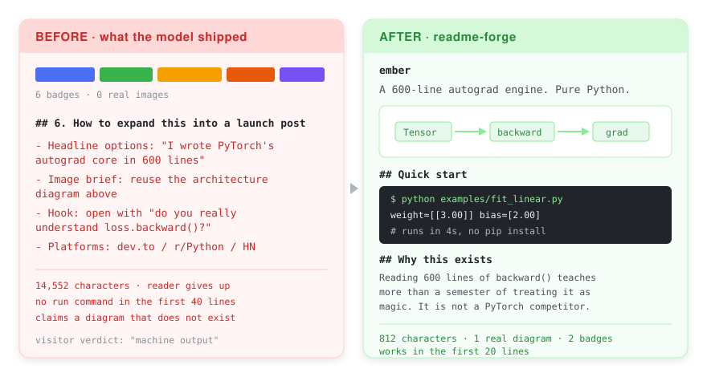

<p align="center">
  <picture>
    <source media="(prefers-color-scheme: dark)" srcset="assets/logo-dark.svg">
    
  </picture>
</p>

<p align="center">
  <em>Your model wrote a README. Half of it was addressed to itself.</em>
</p>

<p align="center">
  
  
  
</p>

<p align="center">
  
</p>

<p align="center"><sub><a href="i18n/README.zh-CN.md">简体中文</a> · <a href="i18n/README.ja.md">日本語</a></sub></p>

---

An Agent Skill that audits a GitHub README and rewrites it for the reader instead
of the author.

## The failure it targets

Ask a model to write a README and it often ships two documents in one. The first
is the README. The second is the launch plan it wrote for itself:

```markdown
## How to expand this into a launch post

- Headline options: "I wrote PyTorch's autograd core in 600 lines"
- Image brief: reuse the architecture diagram above
- Platforms: dev.to / r/Python / Hacker News
```

Two problems. It is addressed to the author, and it claims a diagram that was
never drawn. A visitor concludes "machine output" and leaves.

This skill runs a 13-point audit, quotes every offending line back, and rewrites
the README to a fixed skeleton: **300 to 800 characters**, one real diagram, three
live badges, and a quick start that runs within the first 20 lines.

## Install

```bash
git clone https://github.com/WsNodeX/readme-forge ~/.claude/skills/readme-forge
```

Or as a Claude Code plugin:

```bash
/plugin marketplace add WsNodeX/readme-forge
/plugin install readme-forge
```

Plain Markdown, so it also runs on Codex, Cursor, Cline, Gemini CLI and Kiro.

## Quick start

```bash
python scripts/readme-audit.py --dir path/to/repo
```

```text
WsNodeX/ember     11540 chars   6 badges   0 images   9 patterns  FAIL
    x author-facing text: headline shortlist
    x zero real images, and claims a diagram that does not exist
    x first code block on line 81, limit is 40
```

Then hand it to your agent: `Use the readme-forge skill on WsNodeX/ember.`

## What it checks

| Rule | Fails when |
|---|---|
| Author-facing text | Contains a launch plan, headline shortlist or image plan |
| Platform promotion | Names where to post the article |
| Badge economy | More than three badges, or all of them static |
| Real images | Zero non-badge images |
| Phantom assets | Describes a diagram `git ls-files` cannot find |
| Unwitnessed numbers | A test count with no command behind it |
| Length | Over 4,000 characters |
| Time to first code | First runnable block after line 40 |

## Why this exists

Most README advice optimizes prose. Prose is not the problem — a README written for
the wrong reader fails no matter how well it is written.

The rule that earns its keep is the phantom asset check: a model writing "reuse the
architecture diagram above" is describing a file it never created. Mechanically
checkable, so it gets checked.

The hard part was separating use from mention — a README documenting a bad example
has to quote it, so text rules run on prose only.

## Limitations

- **Cannot rescue an empty project.** If the code has nothing to say, the audit says
  so and stops.
- **Does not grow stars.** A clean README removes the reason visitors bounce; it does
  not create the reason they arrive.
- **Remote audit needs `api.github.com`**, capped at 60 repos/hour without a token.

## Worked example

[docs/case-study-26-repos.md](docs/case-study-26-repos.md) — 26 real repos audited:
200 violations, 19 broken API examples, 3 unfindable bugs.

## License

MIT
