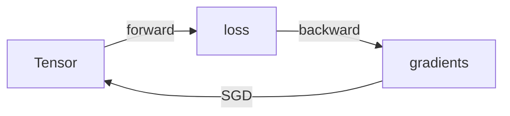

# Ember

A 600-line autograd engine in pure Python. Reverse-mode differentiation, an SGD
optimizer, and a small `nn` layer — no NumPy, no install step.



## Quick start

```bash
python examples/fit_linear.py
# weight ≈ [[3.00]]   bias ≈ [2.00]
# 200 steps in 1.4s, no pip install
```

```python
import ember as eb
x = eb.Tensor([2.0])
y = (x * x).sum()
y.backward()
print(x.grad)      # [4.0]
```

## Why this exists

Every framework rests on two ideas: a tensor that remembers how it was built, and
a backward pass that walks that record. Ember implements exactly those two, plus
enough scaffolding to train something small.

It is not a PyTorch competitor. It is the thing PyTorch is made of, shrunk until
you can read all of it in one sitting — which is the only reason it is worth
reading instead of importing the real one.

## Benchmarks

```bash
python bench.py
# ember:      12.4 ms  (pure Python matmul, 128x128)
# numpy:       0.31 ms
# ratio:        40x slower
```

The honest number is 40x. Ember is a teaching artifact; if you need speed, use
NumPy, and this repo's only remaining value is showing you what NumPy is doing.

## Limitations

- **40x slower than NumPy** on 128×128 matmul. Fine for learning, wrong for training.
- **No N-D tensors** — scalars, vectors and matrices only. No convolutions.
- **Not thread-safe.** The engine assumes a single writer.

## License

MIT
